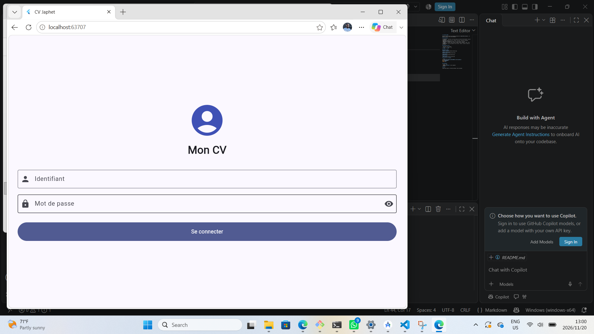
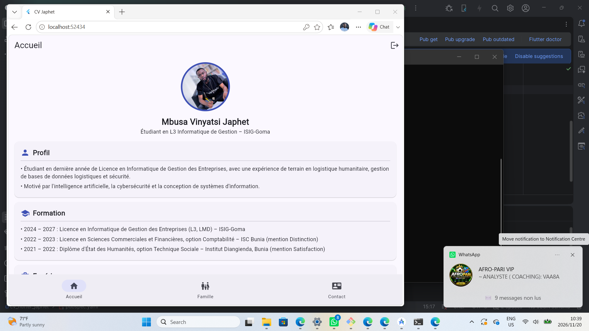
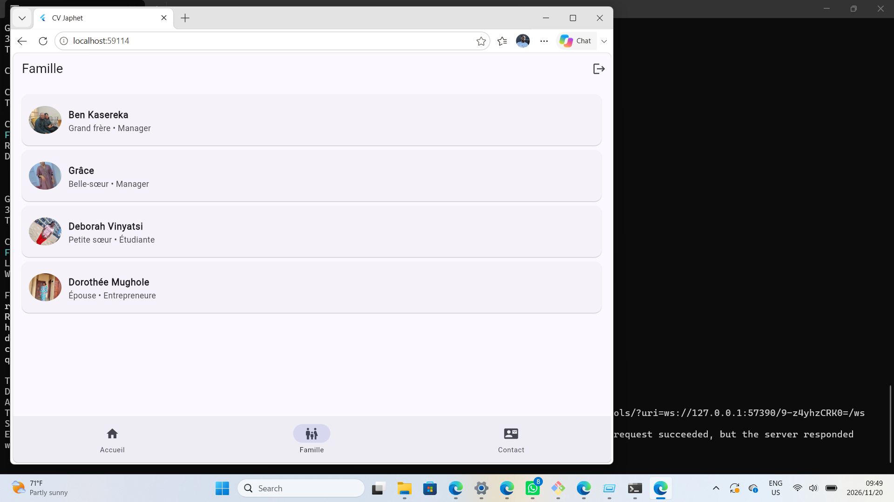
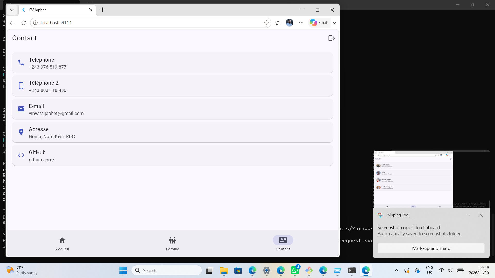

# cv_flutter_japhet

Application mobile Flutter de présentation personnelle de **Japhet Mbusa Vinyatsi** : CV, famille et contact, avec écran de connexion.

## Fonctionnalités

- **Connexion** : identifiant, mot de passe masqué (avec bouton afficher/masquer), bouton « Se connecter »
- **Accueil** : photo, nom, profil, formation, expériences, compétences techniques, langues, centres d'intérêt
- **Famille** : liste de cartes (photo, nom, lien de parenté, profession)
- **Contact** : téléphone, e-mail, adresse, LinkedIn, GitHub (cliquables : appel, e-mail, lien web)
- **Navigation** : barre de navigation en bas (Accueil / Famille / Contact) et bouton de déconnexion

## Identifiants de test

| Identifiant | Mot de passe |
|-------------|--------------|
| `japhet`    | `1234`       |

## Captures d'écran

### Page de connexion


### Page d'accueil (CV)


### Page famille


### Page contact


## Installation et lancement

```bash
git clone https://github.com/vinyatsijaphet-gif/cv_flutter_japhet.git
cd cv_flutter_japhet
flutter pub get
flutter run
```

## Technologies

- Flutter / Dart
- Package `url_launcher` (liens cliquables)
- Material 3

## Auteur

Japhet Mbusa Vinyatsi, LIC3 LIAGE, ISIG-Goma, travail individuel